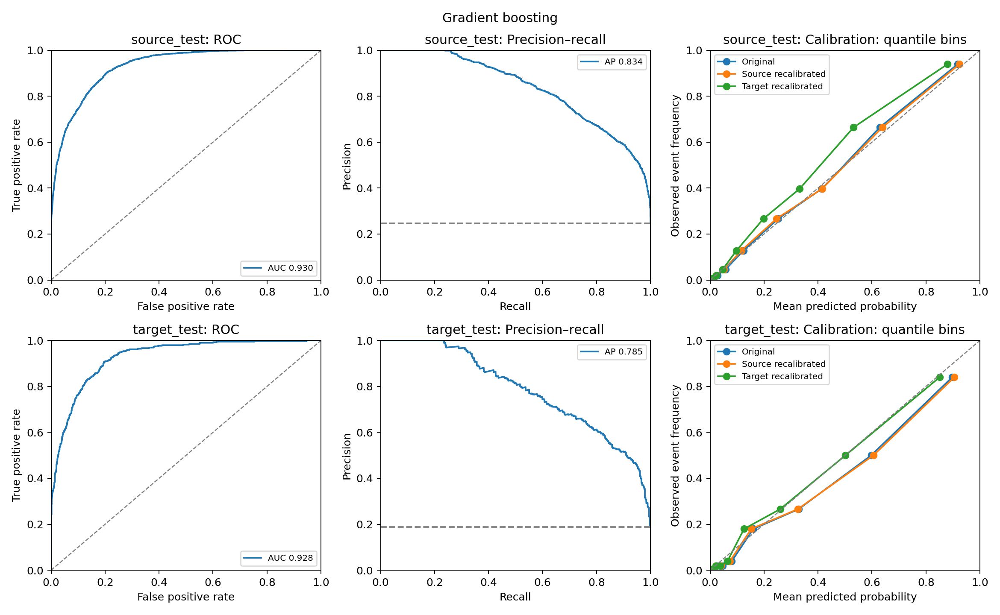

# Model Reliability Under Data Shift

**Does a model trained on one population give equally reliable probabilities in another?**

A completed, reproducible portfolio project comparing income prediction in US-born and foreign-born respondents in the public UCI Adult dataset. It demonstrates established statistical validation methods, not novel research. The central finding is that ranking can remain stable while calibration changes—and that a better Brier score does not, on its own, establish better calibration across populations.



## What this project demonstrates

- A defensible observed population split rather than artificially corrupting rows.
- Logistic regression and nonlinear gradient-boosted trees, with training-only preprocessing.
- Separate source and target evaluation, ROC-AUC, average precision, Brier scores and calibration curves.
- Cluster-bootstrap uncertainty, independent population comparisons and paired recalibration comparisons.
- A labeled-target adaptation experiment that never uses final test labels to fit a recalibrator.
- Interpretation grounded in assumptions, prevalence, case mix and limitations.

The emphasis is on specifying a statistical question, choosing assumptions, validating predictions and explaining uncertainty.

## Data and question

[UCI Adult](https://archive.ics.uci.edu/dataset/2/adult), contributed by Barry Becker and Ronny Kohavi, contains 48,842 historical records. The binary outcome is income greater than $50,000. UCI describes extraction from a 1994 Census database under explicit selection rules. See [data provenance and licensing](data/README.md).

**Source:** recorded birthplace `United-States`. **Target:** another recorded birthplace. Both populations are respondents in the same dataset; “foreign-born” does not mean residents of foreign countries. Birthplace is not citizenship. These are operational dataset labels: the “Foreign-born” group also includes recorded US territories such as Puerto Rico and Guam. It should therefore be read as “other recorded birthplace,” not a precise legal or Census nativity classification.

We combine the supplied training and test files and create our own grouped partitions. The original partition is not treated as a temporal split, and our scores are not intended for comparison with the standard Adult benchmark. Unknown birthplace records are excluded (857); 51 exact full-row duplicates are removed. All 47,934 remaining rows are retained, including 3,893 rows belonging to predictor profiles with conflicting outcomes. Retaining ambiguity avoids making the task artificially easy.

Within each population, records sharing the entire modeled predictor profile stay in a single partition. The 40,524 unique groups are split using a fixed seed and stratification by group majority outcome. Different people can naturally share predictor values across source and target populations; their labels are never transferred across domains.

## Experimental design

The split is specified before evaluation. Source groups are allocated 60% training, 20% calibration and 20% test; target groups are divided equally between calibration and test. Row counts differ from group proportions:

- Source training: **26,234** records; source calibration: **8,711**; source test: **8,847**.
- Target calibration: **2,074** records; target test: **2,068**.
- Source-test outcome prevalence: **24.71%**; target-test prevalence: **18.71%**.

Target labels are used only in the target-calibration adaptation arm and final evaluation. Neither final test set determines preprocessing, parameters or model selection. We report both predeclared models and all calibration variants.

### Predictors and preprocessing

Numeric: age, education years, capital gain, capital loss, hours per week. Categorical: work class, marital status, occupation, relationship, race and sex. Medians, category modes, numeric scaling and one-hot encoding are fitted on source training only. Unknown categories are ignored at evaluation. We retain missing rows and impute predictors.

`native-country` defines the population and is excluded from predictors. `education` is redundant with `education-num`; `fnlwgt` is a survey weight and is excluded from predictors. Results are unweighted record-level evaluations, not survey estimates of the US population. Sensitive attributes are retained for a transparent educational exercise; this choice is not a deployment recommendation.

### Models

1. **Logistic regression:** L2 penalty, C=1, maximum 2,000 iterations. Assumes additive linear log odds after encoding and scaling.
2. **Histogram gradient boosting:** 150 iterations, learning rate 0.08, at most 15 leaves, L2 regularization 1, no early stopping. Captures nonlinearities and interactions with the same input preprocessing. This scikit-learn model provides the stronger comparison without an XGBoost dependency.

These settings are fixed, not selected through target-test tuning. There is no claim that they are optimal.

## Executed results

Original, unrecalibrated predictions; brackets show 95% percentile cluster-bootstrap intervals, 500 resamples. ROC-AUC and average precision are higher-is-better; Brier score is lower-is-better.

| Model | Evaluation population | ROC-AUC [95% CI] | Average precision [95% CI] | Brier [95% CI] |
|---|---|---|---|---|
| Logistic regression | US-born | 0.9064 [0.8994, 0.9134] | 0.7694 [0.7516, 0.7842] | 0.1039 [0.0991, 0.1085] |
| Logistic regression | Foreign-born | 0.9077 [0.8910, 0.9230] | 0.7069 [0.6628, 0.7527] | 0.0917 [0.0835, 0.0992] |
| Gradient boosting | US-born | 0.9297 [0.9233, 0.9360] | 0.8338 [0.8199, 0.8489] | 0.0892 [0.0848, 0.0942] |
| Gradient boosting | Foreign-born | 0.9279 [0.9138, 0.9411] | 0.7848 [0.7466, 0.8203] | 0.0798 [0.0723, 0.0874] |

### Interpretation

**ROC-AUC is similar across populations in this split.** Target-minus-source changes are +0.0014 for logistic regression (95% interval −0.0151 to +0.0159) and −0.0018 for boosting (−0.0178 to +0.0136). These intervals do not establish equivalence; they include no difference.

**Average precision falls:** −0.0624 for logistic regression and −0.0490 for boosting; both bootstrap difference intervals exclude zero. PR-AUC is reported as average precision, not trapezoidal area. Because prevalence also falls, this is not evidence that birthplace alone causes poorer ranking.

**Brier scores improve on the shifted sample**, by 0.0122 and 0.0094 respectively. Raw Brier scores depend on prevalence and case mix as well as calibration. For perspective, an evaluation-prevalence constant prediction has Brier score approximately 0.1860 on source and 0.1521 on target. These are descriptive references using test prevalence, not trained baselines.

**Calibration changes despite stable AUC.** Test-set calibration diagnostics estimate intercept/slope of 0.082/1.038 on source versus −0.422/0.862 on target for logistic regression, and 0.095/1.104 versus −0.366/0.987 for boosting. Ideal values are 0/1. Negative target intercepts suggest overprediction conditional on original score; slopes add information about the spread of probabilities. These diagnostics use test labels for description only and never change predictions.

### Does recalibration help?

An approximately unpenalized logistic recalibrator fits `logit(p_new) = intercept + slope × logit(p_original)` on a separate calibration partition. We compare original, source-recalibrated and target-recalibrated probabilities. Probabilities are clipped to [1e-6, 1−1e-6] before taking log odds. Positive fitted slopes preserve ranking except for numerical clipping ties.

- Logistic target Brier: **0.09169 → 0.08986** after target recalibration. Paired change −0.00183, 95% interval **[−0.00425, +0.00078]**.
- Boosting target Brier: **0.07978 → 0.07804**. Paired change −0.00175, interval **[−0.00349, +0.00014]**.

Both point estimates improve, but both intervals include zero. Applying the target recalibrator back to source instead worsens Brier scores by 0.00558 and 0.00301, with intervals excluding zero. Calibration adjustments are population-dependent. This target adaptation assumes access to labeled target records; it is not a solution for unlabeled shift.

See [all numerical results](reports/metrics.csv), [population differences](reports/shift_deltas.csv), [paired Brier changes](reports/paired_brier_deltas.csv), [diagnostics](reports/calibration_diagnostics.csv) and the [executed notebook](notebooks/01_model_reliability.ipynb).

## Uncertainty and interpretation assumptions

Bootstrap resampling operates on predictor-profile groups to account for repeated modeled profiles. Population differences resample source and target independently. Recalibration differences are paired on the same test observations. All intervals condition on the fitted models, fitted recalibrators and selected split. They do not capture training or calibration-fitting uncertainty, survey-design dependence, or variation across random splits. They are not simultaneous confidence intervals across all comparisons.

Calibration curves use ten quantile bins, which can collapse when scores tie. Bin boundaries differ across populations and variants; curves are descriptive, with no bin-level uncertainty bands. A test diagnostic intercept/slope is not a formal calibration test. Subgroup metrics by sex are exploratory, without multiple-comparison correction or fairness certification.

Logistic coefficients are conditional associations, not causal effects. Numeric effects correspond to source-training standard deviations. One-hot categories use all levels plus regularization, so coefficients are not simple reference-category odds ratios. Correlation and selection limit their interpretation.

## Limitations

This is a within-dataset population comparison, not temporal or independent external validation. The selected 1994-era records are unsuitable for claims about today's population or income. Foreign-born respondents are a heterogeneous pooled group; birthplace is observational, and differences cannot be assigned a causal interpretation. The source selection rules, missingness and unweighted evaluation limit generalization. Household or survey dependence may remain unobserved. Omitted variables, historical discrimination and sensitive predictors limit any consequential use. The experiment does not isolate pure covariate shift, label shift or concept shift, and does not prove fairness or deployment readiness.

Useful extensions include repeated grouped splits, refitting the full model/calibration pipeline inside a bootstrap, country-specific validation where counts permit, sensitivity to removing sensitive attributes, and properly justified survey weighting. These are proposed extensions, not completed results.

## Run it

Tested with **Python 3.12.7** and the pinned core packages in `requirements.txt`. Start in this repository folder:

```bash
python3 -m venv .venv
source .venv/bin/activate
python -m pip install -r requirements.txt
python src/run_analysis.py --bootstrap 500
python src/verify_results.py
jupyter lab notebooks/01_model_reliability.ipynb
```

The pipeline resolves paths relative to its own file. It downloads the original UCI files if absent; included raw data allow the analysis to run offline after installing dependencies. On machines with many cores, optionally set `OMP_NUM_THREADS=2` and `OPENBLAS_NUM_THREADS=2`. To change bootstrap precision use `--bootstrap 2000`; results and run metadata will be overwritten. The notebook loads those outputs rather than silently refitting models, and is delivered with all eight code cells executed. Rerun its cells after rebuilding the analysis.

Random seeds, raw-data SHA-256 hashes, package versions and cleaning counts are recorded in [run_metadata.json](reports/run_metadata.json). Predictions and a split manifest are retained for independent audit. Core analysis was run; every saved metric was independently recomputed from saved predictions, and split integrity and input hashes passed verification. Floating-point results may vary slightly across platforms.

## Repository guide

```text
src/run_analysis.py                 complete experiment and figure generation
src/verify_results.py               split, provenance and numerical checks
notebooks/01_model_reliability.ipynb executed EDA and analysis walkthrough
requirements.txt                   pinned analysis and notebook dependencies
data/raw/                          original public UCI data and descriptions
reports/metrics.csv                scores and bootstrap intervals
reports/predictions.csv            individual test predictions
reports/split_manifest.csv         auditable grouped partition membership
reports/population_summary.csv     sample counts and EDA
reports/missingness.csv             predictor missingness by population
reports/subgroup_metrics.csv        exploratory sex subgroup results
reports/logistic_coefficients.csv   conditional log-odds coefficients
reports/recalibration_parameters.csv fitted calibration transformations
reports/calibration_diagnostics.csv descriptive test calibration fits
reports/shift_deltas.csv            independent domain-difference intervals
reports/paired_brier_deltas.csv     paired target recalibration differences
reports/run_metadata.json          seed, versions and data fingerprints
reports/figures/                    publication-style static charts
```

## Sources and licensing

- Becker, B. and Kohavi, R. Adult. [UCI Machine Learning Repository](https://doi.org/10.24432/C5XW20). Data license: CC BY 4.0.
- [scikit-learn calibration documentation](https://scikit-learn.org/1.5/modules/calibration.html) for probability calibration and interpretation.
- Ding et al., [Retiring Adult: New Datasets for Fair Machine Learning](https://arxiv.org/abs/2108.04884), for discussion of Adult's external-validity limitations.

Project code and documentation are MIT licensed; the source data retain their separate license. This repository was built with AI assistance; the methods, results and limitations are documented for independent review.
